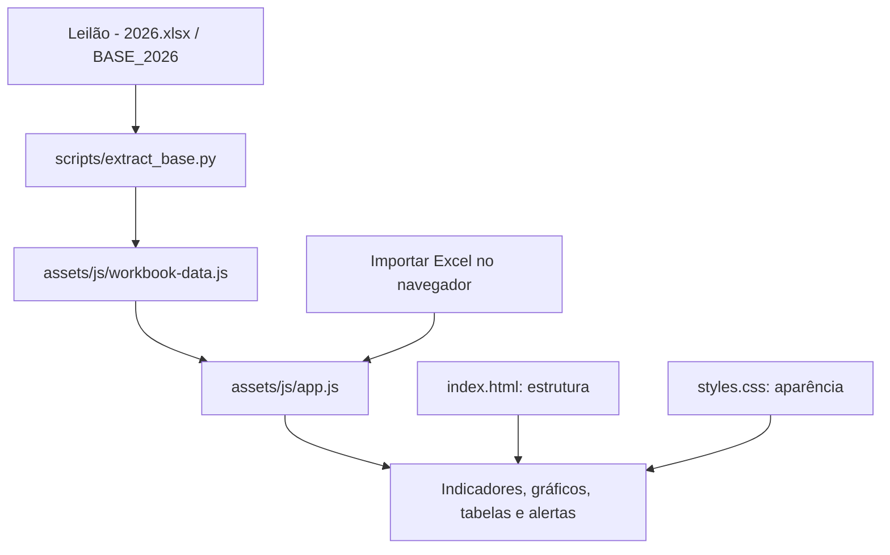

# Entendendo o projeto LogiSight

## Objetivo

O LogiSight transforma os registros da planilha `Leilão - 2026.xlsx` em um dashboard para acompanhar a carteira de veículos. O usuário pode consultar status, etapas do processo, unidades operacionais (CDVs), eventos de leilão, valores e pendências sem precisar analisar cada linha do Excel manualmente.

O projeto é um protótipo local. A interface funciona no navegador e utiliza a aba `BASE_2026` como principal fonte de dados.

## Como as partes se conectam



Existem dois caminhos para carregar dados: uma cópia inicial salva no projeto e uma importação feita pelo usuário durante o uso do dashboard.

## Fluxo completo de funcionamento

1. **Preparação da base inicial:** `scripts/extract_base.py` abre `Leilão - 2026.xlsx`, seleciona a aba `BASE_2026` e grava os registros em `Dashboard_Inteligencia_Logistica/assets/js/workbook-data.js`. Essa etapa é executada manualmente quando se quer atualizar os dados que serão carregados na próxima abertura.
2. **Abertura da página:** `index.html` carrega os estilos, as cópias locais das bibliotecas Chart.js e SheetJS e, ao final, os scripts `demo-data.js`, `workbook-data.js` e `app.js`, nessa ordem. A ordem importa: `app.js` usa os dados de `workbookBase` e as bibliotecas já carregadas.
3. **Preparação dos registros:** `app.js` inicia a sessão copiando `workbookBase` para a lista de registros ativa. Os nomes de colunas são reconhecidos por aliases para acomodar cabeçalhos alternativos; valores numéricos, datas, textos e células vazias são convertidos ou formatados para apresentação.
4. **Cálculo e apresentação:** `renderizar()` aplica os filtros selecionados, calcula totais e agrupamentos, e preenche os indicadores, gráficos, tabelas e alertas das telas. As alterações nos filtros provocam uma nova renderização. As buscas de frota e histórico refinam as tabelas correspondentes.
5. **Importação durante o uso:** o usuário pode escolher `.xlsx`, `.xls` ou `.csv`. O SheetJS lê o arquivo no navegador; a aba `BASE_2026` é priorizada e, se não existir, a primeira aba é utilizada. Linhas sem placa reconhecida não entram na base importada. Os dados substituem os da sessão atual, sem alterar o arquivo original nem a cópia inicial.
6. **Exportação:** a opção **Exportar CSV** baixa os registros que correspondem aos filtros ativos. A tela de importação também oferece um CSV simples com os nomes de colunas recomendados.

Assim, a extração com Python prepara a base que acompanha o projeto; no uso normal, o navegador exibe essa cópia. A importação feita pelo usuário é um caminho separado para analisar outro arquivo ou atualizar os dados apenas enquanto a página estiver aberta.

## Responsabilidade de cada arquivo

| Arquivo | Responsabilidade |
| --- | --- |
| `Dashboard_Inteligencia_Logistica/index.html` | Define o menu, as telas, os botões e os espaços onde os dados são apresentados. |
| `Dashboard_Inteligencia_Logistica/assets/css/styles.css` | Define cores, tamanhos, espaçamentos, cartões e adaptação para telas menores. |
| `Dashboard_Inteligencia_Logistica/assets/js/app.js` | Lê os registros, aplica filtros, calcula indicadores e atualiza gráficos, tabelas e alertas. Também controla a navegação, a importação e a exportação. |
| `Dashboard_Inteligencia_Logistica/assets/js/workbook-data.js` | Armazena a cópia inicial dos registros de `BASE_2026`, na variável `workbookBase`. É gerado pelo script de extração. |
| `Dashboard_Inteligencia_Logistica/assets/js/demo-data.js` | Mantém exemplos fictícios de referência. A abertura atual utiliza a base real de `workbook-data.js`. |
| `scripts/extract_base.py` | Converte os registros da planilha em dados que o JavaScript consegue carregar diretamente. |
| `Leilão - 2026.xlsx` | Arquivo de trabalho original, mantido na raiz. |
| `Dashboard_Inteligencia_Logistica/data/modelo_base_logistica.xlsx` | Modelo genérico do protótipo, com campos que podem diferir dos utilizados na base real. |
| `README.md` | Reúne as instruções práticas de execução e atualização. |

## O que acontece ao abrir a página

O navegador carrega o HTML e o CSS, além das bibliotecas externas. Em seguida, carrega `demo-data.js`, `workbook-data.js` e `app.js`, nessa ordem.

O JavaScript copia os registros de `workbookBase` para a base usada na sessão. A função `renderizar()` em `assets/js/app.js` calcula os indicadores e preenche a interface. `dadosFiltrados()` considera os filtros de status, CDV e evento antes dos cálculos; ao mudar um filtro, as telas que usam esses dados são atualizadas. As buscas textuais de frota e histórico também restringem as respectivas tabelas.

A quantidade de veículos vendidos na visão geral considera os registros com status `VENDIDO`. A barra da carteira apresenta a proporção desses veículos em relação ao total filtrado. Os demais status continuam disponíveis nos gráficos e nas tabelas.

## Como a planilha é interpretada

Cada linha com placa representa um registro de veículo. Os cabeçalhos são usados para identificar o significado de cada coluna.

| Informação | Campos principais |
| --- | --- |
| Identificação | `PLACA`, `MODELO` |
| Situação operacional | `STATUS`, `PROCESSO` |
| Unidade e região | `CDV`, `ÁREA` |
| Valores | `VALOR ESTIMADO`, `VALOR FINAL` |
| Evento e documentação | `LEILÃO`, `DOCUMENTO` |
| Datas | `EntradanoPátio`, `DatadoEvento` |
| Observações | `OBSERVAÇÃO` |

A função `obterCampo()` reconhece os campos por meio de uma lista de nomes alternativos. A função `normalizar()` reduz diferenças de acentuação, letras maiúsculas e separadores. Isso permite reconhecer alguns cabeçalhos escritos de formas diferentes, mas não substitui a conferência do mapeamento na tela **Importar Excel**.

Internamente, o código ainda usa o nome `leiloeiro` para acessar o campo que, nesta base, corresponde ao CDV. Na interface, a análise é apresentada como **Análise por CDV**. O campo `LEILÃO` identifica o evento.

## Telas disponíveis e o que apresentam

- **Visão geral:** mostra o total da carteira, veículos com status vendido, valor estimado e valor final registrado. Os filtros de status, CDV e evento afetam os indicadores, gráficos, alertas e tabela operacional. Os gráficos resumem status, volume por evento e etapa do processo. A tabela pode ser exportada em CSV.
- **Frota e veículos:** apresenta os veículos, status, processo, CDV, área e valores, além de informações de entrada em pátio e pendências. A busca procura texto nos campos do registro.
- **Gestão de leilões:** reúne indicadores de eventos e vendas, gráficos de valor final por evento e distribuição por tipo de documento, mais uma tabela de acompanhamento.
- **Prazos e atrasos:** estima os dias em pátio pela diferença entre a data de entrada e a data atual do navegador; agrupa permanências em faixas e destaca veículos com mais tempo. A regra de alerta considera permanência superior a 90 dias.
- **Valores e resultados:** compara somas de valor estimado e valor final para registros que possuem ambos, apresenta valores finais por evento e detalha os valores por veículo. A diferença entre estimado e final não é lucro; a base não contém todos os custos necessários para calculá-lo.
- **Análise por CDV:** agrupa quantidade de veículos e valores finais por CDV e apresenta quantidades associadas e vendidas. O código utiliza internamente o campo `leiloeiro` para acessar esse dado.
- **Histórico de eventos:** lista registros que possuem evento ou data do evento e permite buscar por evento, placa ou CDV.
- **Alertas de pendências:** cria avisos a partir de pendências preenchidas, resultado de lance recusado/sem lance/reprovado, status ausente e veículos não vendidos com mais de 90 dias em pátio. São regras indicativas, não uma validação automática do estado real da operação.
- **Importar Excel:** permite selecionar arquivos, ver o nome das colunas e conferir quais campos foram reconhecidos. Também oferece o CSV com cabeçalhos recomendados.

## Atualização dos dados

### Atualizar apenas a sessão aberta

Clique em **Atualizar base** ou **Importar Excel** e selecione um arquivo `.xlsx`, `.xls` ou `.csv`.

O importador procura a aba `BASE_2026`. Quando ela não existe, utiliza a primeira aba do arquivo. A primeira linha deve conter cabeçalhos, e os registros sem placa reconhecida são descartados.

Os novos dados ficam na memória da página. Essa operação não altera o Excel original nem o arquivo `workbook-data.js`. Ao recarregar, a página retorna à cópia inicial do projeto.

### Atualizar os dados usados na abertura

Atualize `Leilão - 2026.xlsx` e execute, na raiz do projeto:

```sh
python3 scripts/extract_base.py
```

É necessário ter Python 3 e o pacote `openpyxl` disponíveis. O script:

1. Abre a planilha e seleciona `BASE_2026`.
2. Lê a primeira linha como cabeçalho.
3. Converte datas para texto, remove espaços nas extremidades dos textos e substitui células vazias por uma string vazia.
4. Mantém somente as linhas com `PLACA` preenchida.
5. Gera `assets/js/workbook-data.js` com os registros encontrados.

Recarregue a página para utilizar a nova cópia. O script lê os valores armazenados no Excel; ele não recalcula fórmulas. As demais abas não são exportadas.

## Tecnologias utilizadas

- **HTML:** estrutura da interface e das nove telas, definida em `Dashboard_Inteligencia_Logistica/index.html`.
- **CSS:** apresentação visual e responsividade, definida em `Dashboard_Inteligencia_Logistica/assets/css/styles.css`.
- **JavaScript:** lógica da aplicação em `Dashboard_Inteligencia_Logistica/assets/js/app.js`. Gerencia os dados da sessão, normaliza e formata valores, calcula indicadores, aplica filtros, desenha tabelas, gera alertas e controla os eventos da interface.
- **Chart.js:** biblioteca de gráficos armazenada localmente em `assets/js/vendor/chart.umd.min.js`. A função `criarGrafico()` em `assets/js/app.js` instancia os gráficos de rosca e barras usados nas telas.
- **SheetJS (XLSX):** biblioteca de planilhas armazenada localmente em `assets/js/vendor/xlsx.full.min.js`. Em `app.js`, `XLSX.read()` lê os arquivos importados, `XLSX.utils.sheet_to_json()` transforma a aba selecionada em registros JavaScript e `XLSX.utils.sheet_to_csv()` prepara os dados filtrados para exportação.
- **Python com openpyxl:** usado fora do navegador pelo script `scripts/extract_base.py`. `openpyxl.load_workbook()` lê a planilha original e o script gera `assets/js/workbook-data.js`, que o dashboard pode carregar diretamente.

O frontend não precisa de instalação de dependências, conexão com a internet ou etapa de compilação. Python é necessário para o servidor local opcional e para a extração; `openpyxl` é necessário apenas para o extrator.

## Como executar

Na raiz do projeto:

```sh
python3 -m http.server 8000 --bind 127.0.0.1
```

Acesse [o dashboard local](http://localhost:8000/Dashboard_Inteligencia_Logistica/). Mantenha o terminal aberto e pressione `Ctrl+C` para encerrar o servidor.

Também é possível abrir `Dashboard_Inteligencia_Logistica/index.html` diretamente no navegador, preservando a estrutura de pastas.

## Como interpretar os indicadores

Os totais correspondem à base filtrada. Alterar os filtros pode modificar os números, os gráficos e as tabelas.

A soma dos valores estimados representa os valores preenchidos nessa coluna. A soma dos valores finais representa os valores finais registrados, sem exigir que o status seja `VENDIDO`.

A comparação **Estimado × realizado** utiliza apenas registros com os dois valores preenchidos. A diferença entre os valores não representa lucro, pois a aba não informa os custos necessários para esse cálculo. Valores ausentes são apresentados como `—` na tabela financeira.

Os dias em pátio são calculados com a data de entrada e a data atual do navegador. Os alertas são indicativos: observações registradas não significam necessariamente pendências ainda abertas, e as regras precisam ser revisadas conforme a operação.

## Orientações para manutenção

Para mudar textos e organizar telas, edite o HTML. Para alterar cores ou espaçamentos, edite o CSS. Para mudar cálculos, filtros ou regras de alerta, edite `app.js`.

Preserve os IDs dos elementos usados pelo JavaScript e a ordem dos scripts. Para atualizar a cópia inicial, prefira alterar a planilha e executar o extrator, pois uma nova extração substitui `workbook-data.js`.

Depois de uma alteração, confira a abertura da página, os filtros, as tabelas, a importação de `BASE_2026` e a apresentação em telas menores.

## Limites atuais

O projeto não possui autenticação, banco de dados, histórico persistente de importações nem sincronização automática com o Excel. A leitura de arquivos importados ocorre no navegador, sem envio desses arquivos a um servidor pelo código da aplicação.

A cópia inicial contém dados reais nos arquivos JavaScript do projeto. Ela é carregada por quem abre a página. O protótipo deve ser tratado conforme o acesso permitido à base da operação.

Esta documentação descreve o funcionamento atual. As instruções rápidas de uso estão no [README.md](README.md).
